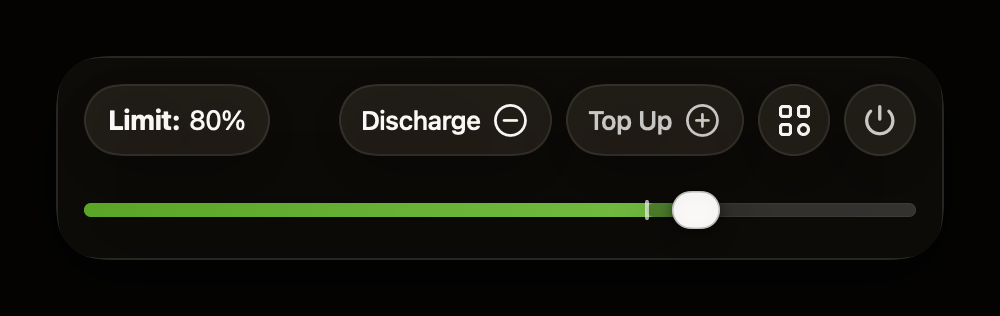
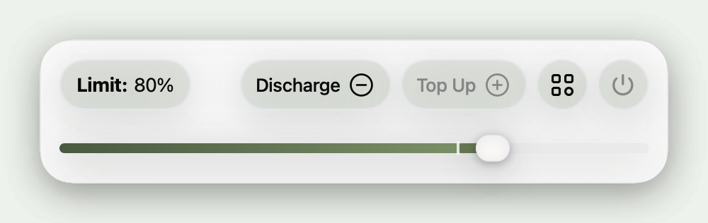
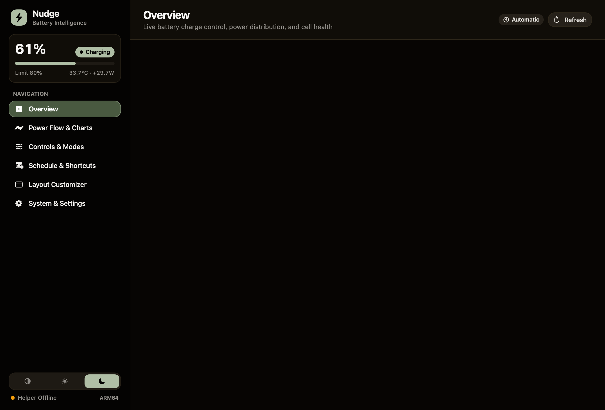
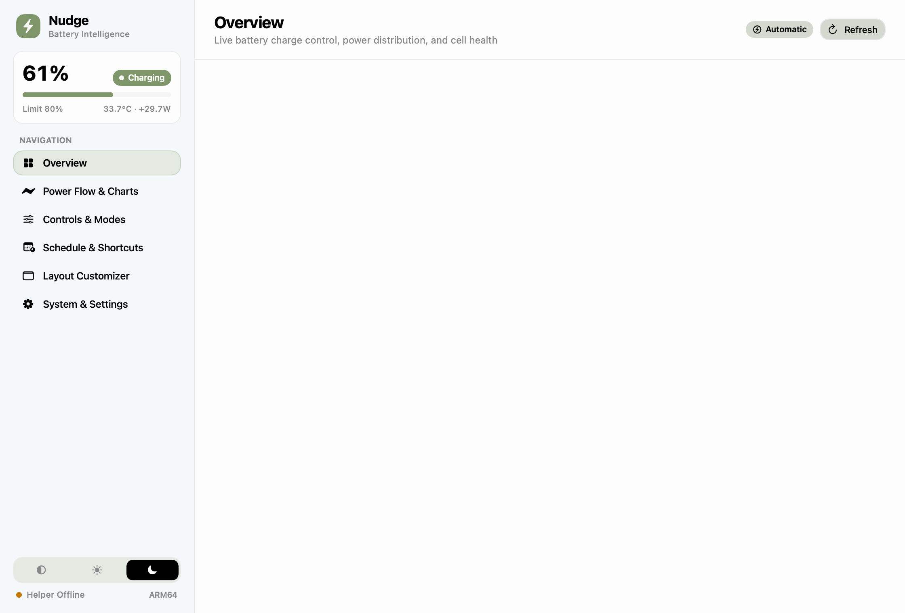

# Nudge ⚡

A native macOS battery care, power telemetry, and charge management suite for Apple Silicon and Intel MacBooks, crafted in Swift, SwiftUI, Swift Charts, IOKit, and App Intents.

Runs cleanly as a **menu-bar-only utility** (`LSUIElement = true`, hidden from the macOS Dock) with an icon-only menu bar trigger, a compact quick-control pill bar, and an on-demand full dashboard window opened from the 2×2 grid button.

Styled with the **Moss** design system ([tweakcn `cmmi1gb4a000204jl8c300w9a`](https://tweakcn.com/themes/cmmi1gb4a000204jl8c300w9a)): deep warm dark bark (`#070503` / `#100d08`) and crisp porcelain (`#fdfdfd`) surfaces, warm `#2f281b` hairline borders, `#495940` deep forest moss accents, sage-moss (`#AFBEA5` / `#7F956A`) controls, `1.4rem` organic corners, tabular monospaced figures, and full Light / Dark / System mode support.

## Screenshots

### Compact Menu Bar Popover (Dark & Light Moss)

| Dark Moss | Light Moss |
| :---: | :---: |
|  |  |

Click the Nudge icon in the top macOS menu bar for instant one-click access to **Limit %**, **Discharge**, **Top Up**, the **2×2 Open App button**, a one-click **Exit** button, and the live **Charge Limit slider**.

### Full Dashboard

| Full Dashboard (Dark Moss) | Full Dashboard (Light Moss) |
| :---: | :---: |
|  |  |

## Download & Install

Grab the latest macOS installer from **[GitHub Releases](https://github.com/emrisca/nudge/releases/latest)**:

- **`Nudge-1.1.2-macOS-arm64.dmg`** — Drag `Nudge.app` into `/Applications`
- **`Nudge-1.1.2-macOS-arm64.zip`** — Portable archive
- **Built-in GitHub Releases Updater** — Nudge automatically checks `emrisca/nudge` for new releases (with optional pre-release channel, SHA-256 verification against `SHA256SUMS.txt`, automatic `xattr -cr`, and one-click **Install & Relaunch**).

> **First Launch (Ad-Hoc Signed Build):** This release is ad-hoc signed and not notarized with an Apple Developer license. After dragging `Nudge.app` to `/Applications`, clear the macOS Gatekeeper quarantine flag in Terminal:
> ```bash
> xattr -cr /Applications/Nudge.app
> ```
> Alternatively, bypass Gatekeeper via **Right-click → Open → Open**, or **System Settings → Privacy & Security → Open Anyway**.

## All 22 Core Features

1. **Charge Limiter** — Hardware SMC intervention (`CH0B`/`CH0C`/`CH0I`/`CHWA` on Apple Silicon, `BCLM` on Intel) to cap charging at 20–100%.
2. **Discharge** — Simulates unplugging to drain the battery toward a target limit while physically connected to power.
3. **Fast User Switching** — Privileged background daemon (`com.emrisca.nudge.helper`) persists SMC limits across macOS user session switches.
4. **Heat Protection** — Live IOKit battery temperature monitoring with configurable threshold (default `35°C`) and a 5-minute (`300s`) hysteresis cooldown to prevent toggle thrashing.
5. **Calibration Mode** — Automated 4-phase cycle (`100% → 10% → 100% → Target Limit`) that safely bypasses Heat Protection during calibration.
6. **Sailing Mode** — Configurable deadband (`5–10%`) below the charge limit where charging remains paused to eliminate micro-cycling.
7. **Automatic Discharge** — Automatically drains the battery whenever `charge_limit < current_battery_percentage`.
8. **Top Up** — Temporarily overrides the charge limit to `100%` for one cycle and reverts automatically upon physical unplug detection.
9. **Stop Charging when Sleeping** — Intercepts `NSWorkspace.willSleepNotification` to pause charging before sleep.
10. **Stop Charging when App Closed** — `SMJobBless` / `SMAppService` LaunchDaemon helper keeps limits enforced even when the UI quits.
11. **Disable Sleep until Charge Limit** — `IOPMAssertionCreateWithName` (`kIOPMAssertionTypeNoDisplaySleep`) keeps the Mac awake until the target limit is reached.
12. **Sleep Control** — Manual or timed keep-awake (`30m`, `1h`, `2h`, `Indefinite`) with automatic fallback triggers (re-enable sleep at `20%` battery or on unplug).
13. **Schedule** — Cron-like recurring task runner with **Catch Up on Missed Tasks** on wake from sleep or app launch.
14. **Apple Shortcuts Integration** — 15 native `AppIntents` actions + `AppShortcutsProvider` Siri phrases (Get/Set Limit, Status, Discharge, Temperature, Top Up, Calibration, Sailing, Heat Protection, MagSafe LED, Power Mode, Keep Awake).
15. **Control MagSafe LED** — SMC `ACLC` key control (`System`, `Green`, `Orange`, `Blinking Orange`, `Off`) with automatic state synchronization.
16. **Hardware Battery Percentage** — Reads raw `AppleSmartBattery` hardware capacity alongside macOS’s smoothed display percentage.
17. **Live Status Icons** — Dynamic menu bar icon reflecting real-time state (`Charging`, `Paused`, `Sailing`, `Discharging`, `Overheated`, `Calibrating`, `Unplugged`).
18. **Menu Bar Customization** — User-reorderable modular menu bar items (Live Icon, macOS %, Hardware %, Temperature, Power Flow W, Cycles, Battery Health %).
19. **Popover Customization** — Compact quick bar + expandable drag-and-drop reorderable & hideable SwiftUI widget dashboard + full resizable Sidebar Application window + Swift Charts historical graphs.
20. **Power Flow** — Real-time wattage flow visualization (Charger Input, Battery In/Out, System Load broken down by SoC, Display, and USB/Peripherals).
21. **Apps Using Significant Energy** — Live `NSWorkspace` + `proc_pid_rusage` energy monitor with CPU %, estimated watts, memory, and safe `terminate()` controls.
22. **Power Mode Control** — View and switch Low Power, Automatic, and High Power modes.
23. **GitHub Releases Auto-Updater** — Tracks `emrisca/nudge` GitHub Releases with background checks (Every 6h / Daily / Weekly), optional pre-releases, SHA-256 checksum verification, one-click Install & Relaunch, Skip Version, and `nudge-cli update`.
24. **Launch at Login** — Starts Nudge automatically in your macOS menu bar on sign-in (enabled by default, toggleable in Settings, using `SMAppService.mainApp` with automatic per-user LaunchAgent fallback).

## Project Structure

- `Sources/NudgeCore/` — Hardware SMC bridge, IOKit `AppleSmartBattery` telemetry, Sailing Mode, Heat Protection, Calibration, Sleep Control, Scheduler, Energy Monitor, Power Mode, Telemetry History Store, XPC client, and `BatteryManager`.
- `Sources/NudgeApp/` — Moss themed SwiftUI Menu Bar Extra (`LSUIElement = true`, no Dock icon), compact quick bar, drag-and-drop Popover Dashboard, Full Application Dashboard, Swift Charts, and Settings.
- `Sources/NudgeHelper/` — Privileged LaunchDaemon (`com.emrisca.nudge.helper`) with `NSXPCListener` and `<1%` idle CPU `DispatchSourceTimer`.
- `Sources/NudgeIntents/` — 15 Apple Shortcuts `AppIntent` actions & `NudgeShortcutsProvider`.
- `Sources/NudgeCLI/` — Full CLI (`status`, `limit`, `discharge`, `topup`, `calibrate`, `sailing`, `heat`, `magsafe`, `powermode`, `apps`, `keepawake`, `update`).
- `Sources/NudgeTestRunner/` & `Tests/NudgeCoreTests/` — Automated verification suite.
- `Resources/`, `scripts/build-app.sh`, `scripts/build-dmg.sh` — App bundle metadata (`LSUIElement = true`), LaunchDaemon plists, Moss `AppIcon.icns`, and headless ad-hoc `.dmg` / `.zip` release packager.

## Build from Source

```bash
# Run verification suite
swift run nudge-test-runner

# Build release Nudge.app + DMG & ZIP installers (ad-hoc signed, no Apple Developer license required)
./scripts/build-dmg.sh --build

# Launch Nudge.app (runs in the macOS menu bar with no Dock icon)
open build/Nudge.app

# Use the CLI
.build/release/nudge-cli status
```
